# 상하이 하루 코스 후기

11월 7일 토요일, 상하이를 하루 동안 걸었습니다. 출발 전에 XenoDay로 코스를 세 가지 짜 봤고, 실제로는 **신천지에서 시작해 와이탄 야경으로 끝나는 동선**으로 다녀왔습니다. 이 글은 그날 동선 그대로, 좋았던 곳과 돈이 아까웠던 곳을 솔직하게 적은 후기입니다.

**이날 동선:** 신천지 → 예상하이 점심 → 티엔즈팡 → 예원 → 인민광장 → 난징동루 → 와이탄 점등 → 2층 관광버스 → The Fellas Terrace 저녁

<!-- TODO(사진): 하루 동선 지도 스크린샷(XenoDay 지도 화면) -->

## 1. 신천지: 11월인데 벌써 크리스마스

신천지는 옛 석고문(石库门) 건물을 고친 거리에 상점과 카페, 식당이 모여 있는 곳입니다. 11월 초였는데 벌써 크리스마스 장식이 한가득이었어요. 거리에 하얗게 쌓인 눈은 **진짜 눈이 아니라 장식용 가짜 눈**인데, 그래도 크리스마스 분위기가 제대로 나서 사진이 정말 예쁘게 나왔어요.

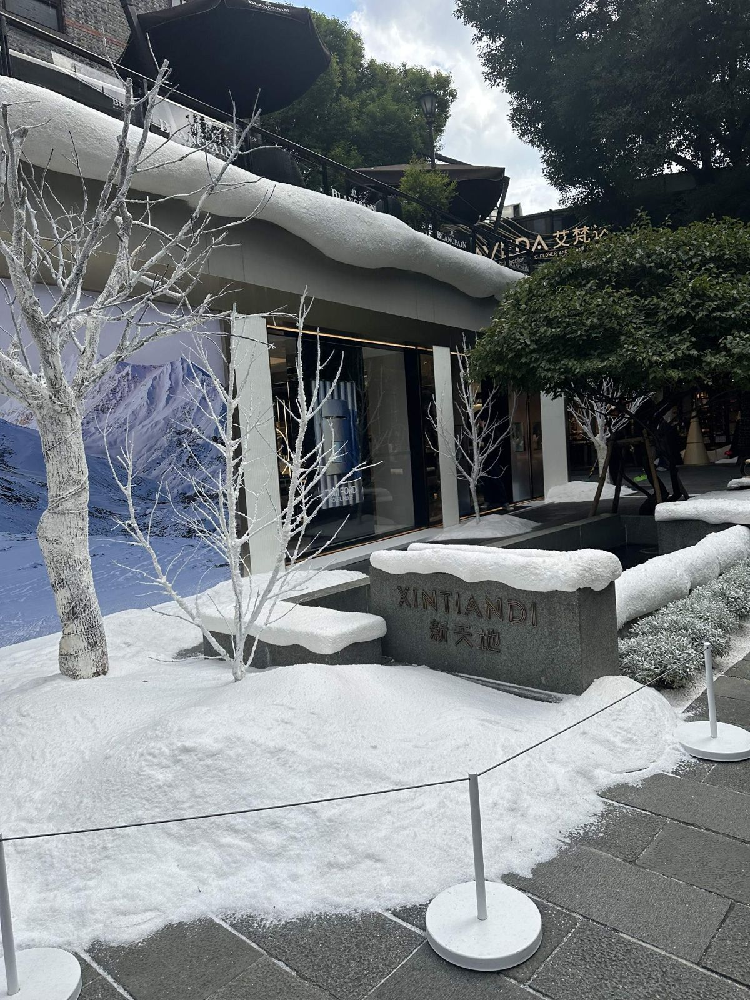
*11월 초 신천지. 눈처럼 보이는 건 전부 장식이에요.*

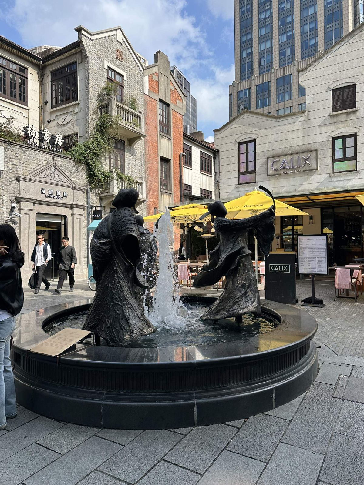
*석고문 건물 사이 분수 광장. 낮에 오면 이렇게 하늘이 예쁘게 나와요.*

- **팁:** 오전에 가면 사람이 적어 사진 찍기 좋습니다. 점심 예약 식당이 근처라면 신천지를 첫 코스로 두는 게 동선상 편해요.

## 2. 예상하이(夜上海) 점심: 고급스럽고, 동파육은 꼭

신천지에 있는 상하이 요리 식당 **예상하이**에서 점심을 먹었습니다. 래퍼 딘딘도 유튜브에서 다녀간 곳이라 기대했는데, 분위기부터 고급스럽고 음식도 대부분 맛있었어요.

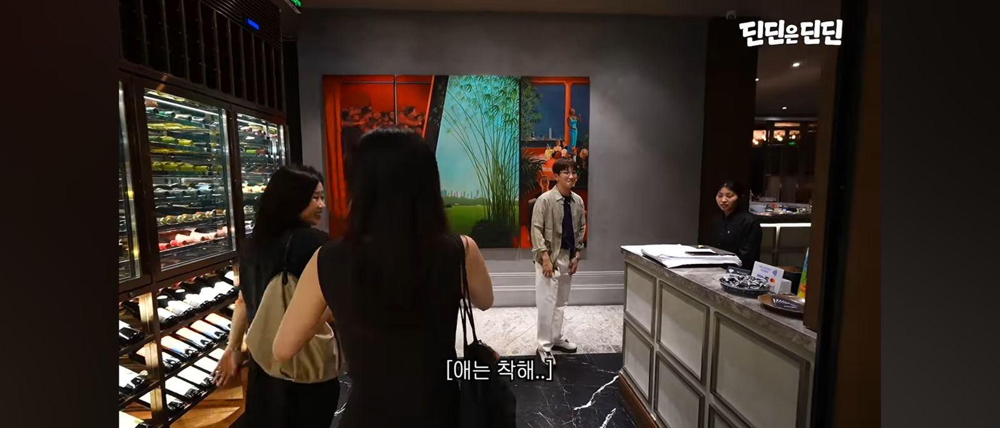
*출처: 유튜브 채널 "딘딘은딘딘" · TODO(확인 필요): 영상 제목과 링크*

- **동파육:** 이 집에서 제일 추천합니다. 입에 넣으면 그냥 녹아 없어져요.
- **베이징덕:** 처음 먹어 봤는데 맛있었어요.
- **오리 껍질 캐비어 초밥:** 바삭한 오리 껍질 위에 캐비어를 올린 한입 요리도 나왔어요. 보기에도 고급스러워요.
- **게 요리:** 저는 좀 별로였어요. 게를 기대하고 가는 거라면 다른 메뉴에 힘을 주는 편이 낫습니다.
- **예약:** 점심 12시로 미리 예약하고 갔습니다. 주말 점심이라면 예약을 권합니다.

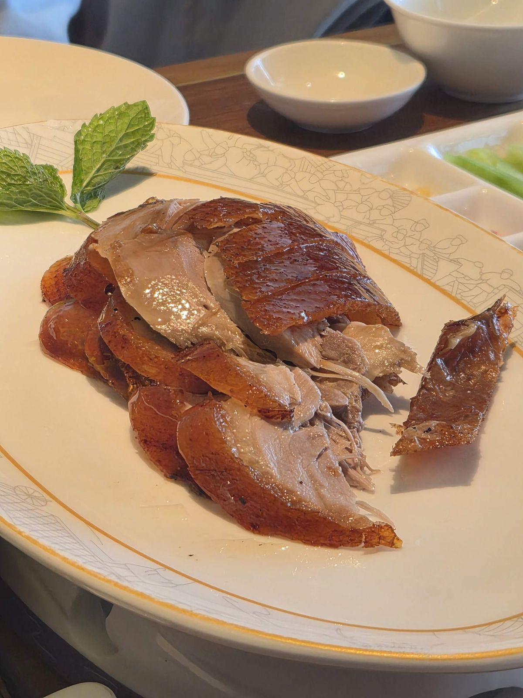
*처음 먹어 본 베이징덕. 껍질이 바삭했어요.*

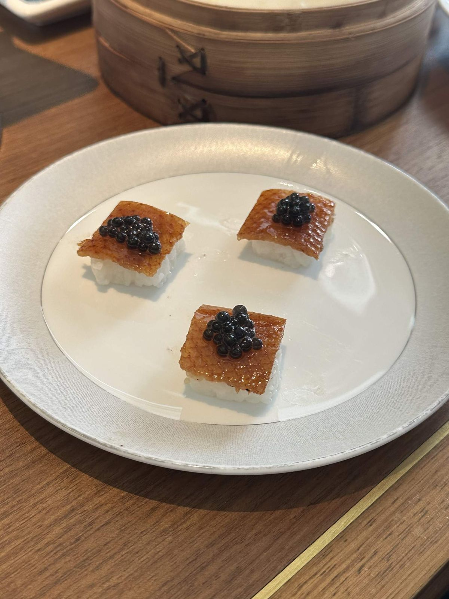

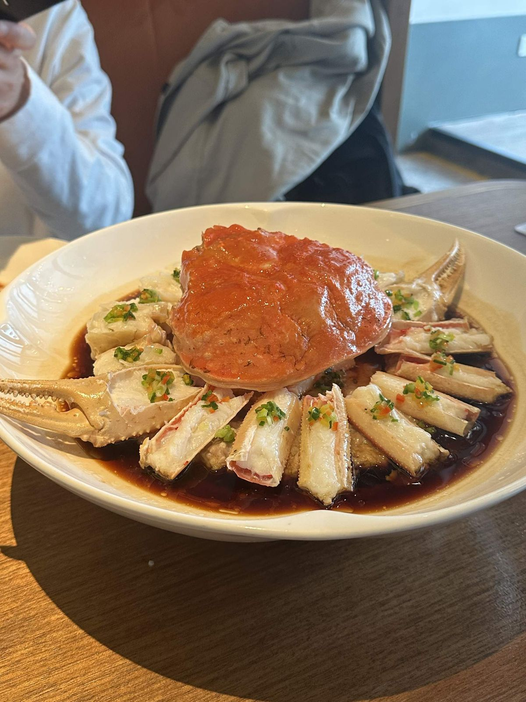
*보기엔 화려했지만 맛은 기대보다 평범했던 게 요리.*

<!-- TODO(사진): 동파육 -->

## 3. 티엔즈팡: 탕후루는 패스, 핸드크림은 "上海"를 새기세요

티엔즈팡은 좁은 골목에 공방, 소품샵, 작은 카페가 모인 곳입니다.

- **탕후루: 비추천.** 냉동이라 맛이 없었고, 가격도 비싼 편이라 돈이 아까웠어요.
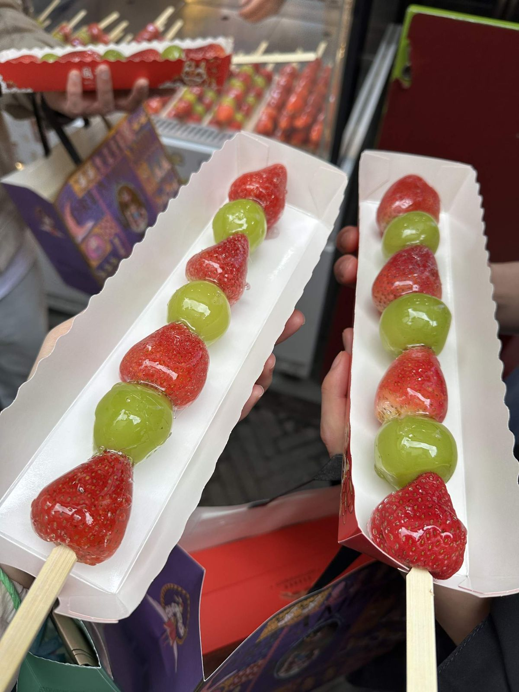
*보기엔 예쁜데 냉동이라 맛이 없었던 탕후루.*

- **핸드크림: 추천.** 뚜껑에 문구나 그림을 새겨 주는 핸드크림 가게가 있습니다.
  - 각인 디자인은 생일 케이크, 上海 스카이라인, I♥SH, 행운 문구 등 여러 가지가 있어요.
  - **이름 말고 "上海(상하이)" 디자인을 새기는 게 이득이에요.** 동방명주와 상하이 타워가 그려져 있어 기념품으로 훨씬 예쁘고, 누구에게 선물해도 어색하지 않아요.
  - 향은 여러 가지인데, 저는 **우드향**이 너무 좋아서 우드향으로 샀어요.
  - **주의:** 각인한 제품은 반품·교환이 안 된다고 매장에 한국어로도 적혀 있어요. 디자인은 꼭 확인하고 맡기세요.

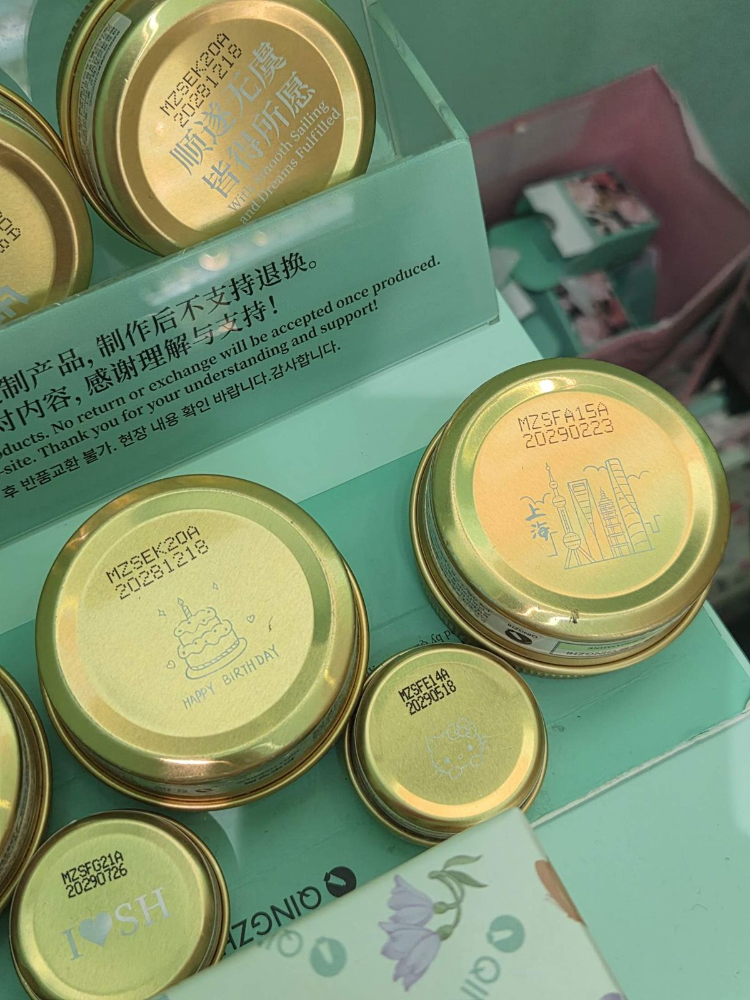
*오른쪽 위가 上海 스카이라인 각인. 생일, I♥SH 디자인도 있어요.*

- **마그넷:** 2024년까지만 해도 예쁜 마그넷을 찾기 어려웠는데, 이번에는 디자인이 다양하고 예쁜 게 많았어요. 저도 하나 샀습니다.

<!-- TODO(사진): 마그넷 -->

## 4. 예원: 사람이 정말 많아요

예원은 옛 정원과 전통 상점가가 함께 있는 관광지입니다. 상점가와 구곡교 주변은 무료이고, **안쪽 정원은 입장료를 내고 들어갑니다.** 저는 정원까지 들어갔어요.

- **사람이 엄청 많습니다.** 주말 오후에는 상점가 골목이 꽉 찹니다.
- **입장료와 시간(참고):** 정원 입장료는 4~6월·9~11월 40위안, 12~3월·7~8월 30위안이라는 안내가 있습니다. 운영 시간은 오전 9시~오후 4시 30분(입장 마감 4시)이고 **월요일은 휴무**입니다 ([trvlogue](https://www.trvlogue.com/en/yu-garden-shanghai-tickets), 2026-11-23 확인). 일정을 정하기 전에 공식 채널에서 한 번 더 확인하세요.
- **팁:** 입장 마감이 4시라 정원까지 보려면 오후 3시 전에는 도착하는 게 안전합니다.

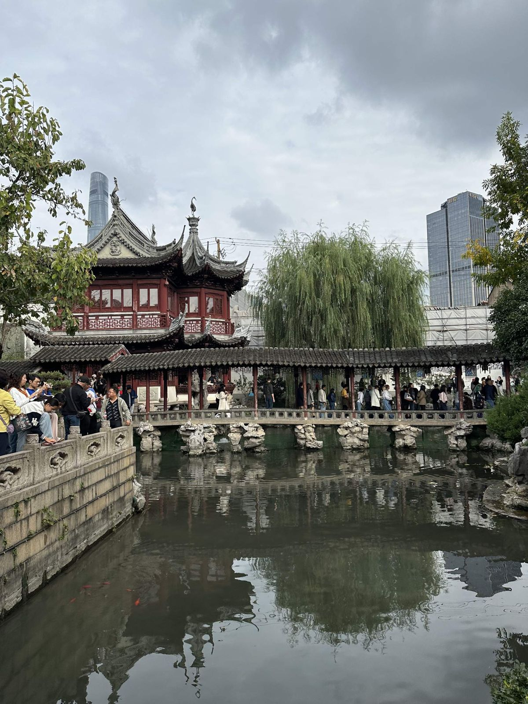
*유료 정원 안쪽. 누각 뒤로 상하이 타워가 보여요.*

## 5. 인민광장: 화장실은 미리미리

신천지에 이어 인민광장에도 들렀어요. 여기는 **줄이 너무 길고 한국 사람이 정말 많아서** 제대로 된 사진은 못 찍었어요. 앞에서 살짝 한 장 찍은 게 전부예요. 주말에 간다면 사람이 많을 거라고 생각하고 가세요.

<!-- TODO(사진): 인민광장 앞에서 살짝 찍은 사진 -->

인민광장에서는 스타벅스에도 잠깐 들렀습니다. 그런데 **매장 안에 화장실이 없었어요.** 건물 공용 화장실을 써야 했는데, 줄이 정말 길었습니다.

- **팁: 화장실은 보일 때 미리 가세요.** 이 주변은 사람이 많아서 급할 때 찾으면 꽤 기다려야 합니다. 점심 식당이나 쇼핑몰처럼 시설이 좋은 곳에서 미리 들르는 걸 추천해요.
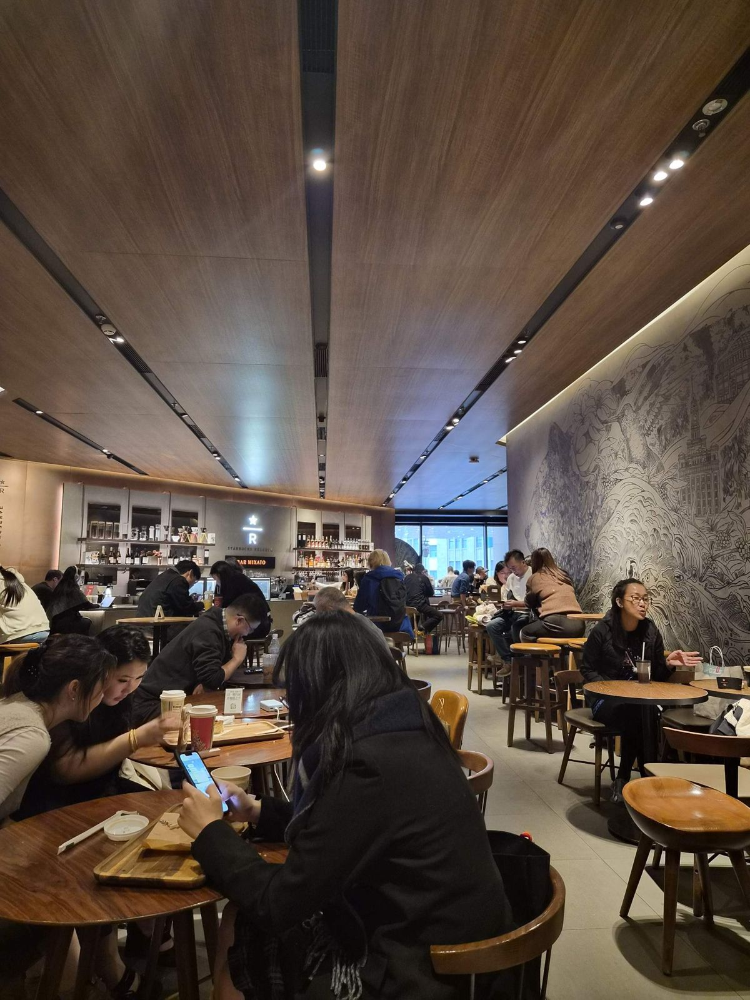
*매장은 넓고 예쁜데 안에 화장실이 없어요.*

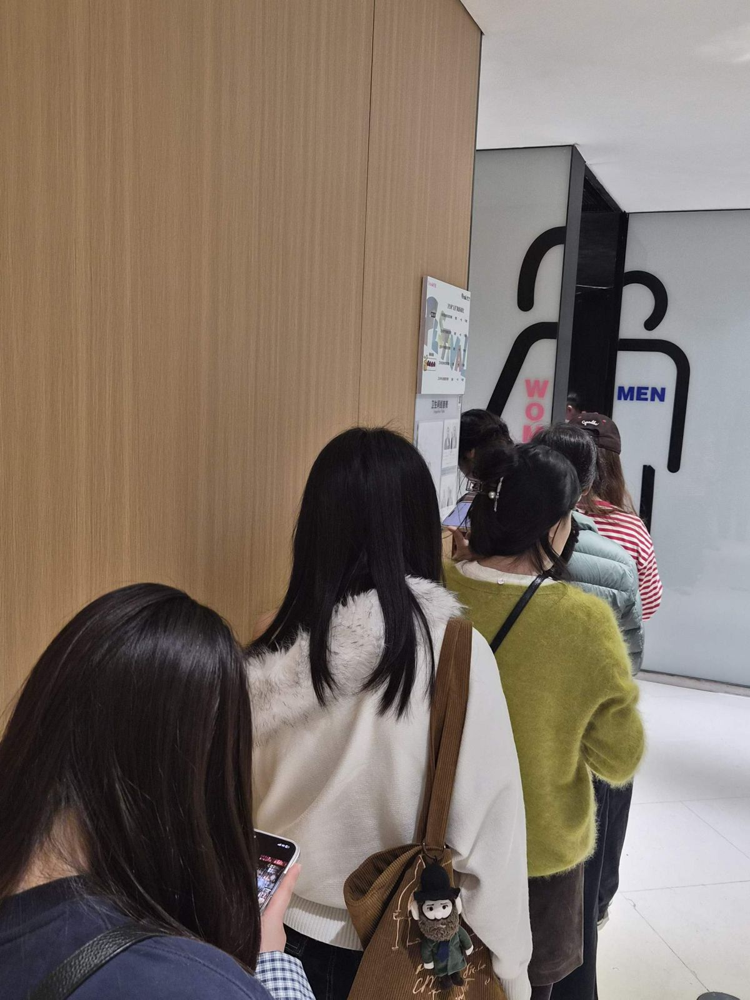
*건물 공용 화장실 줄. 미리미리 가세요.*

- **레고 스토어:** 대형 레고 작품이 많아 둘러보는 재미가 있었어요.
- **M&M's 스토어:** 벽 한 면을 채운 "초콜릿 장성(Great Wall of Chocolate)"에서 원하는 색을 골라 담을 수 있어요. 구경만 해도 즐거웠습니다.

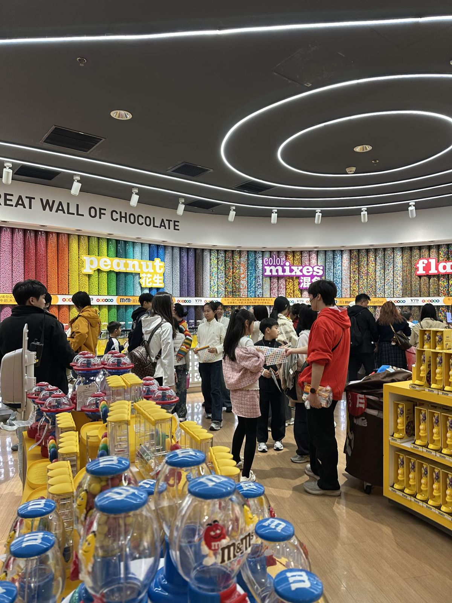

<!-- TODO(사진): 레고 매장 -->

## 6. 난징동루: 피규어샵과 치이카와

인민광장에서 와이탄까지 난징동루를 따라 걸었습니다. 길을 따라 피규어샵과 토이샵이 이어져 있어서 하나씩 들어가 보는 재미가 있어요.

- **피규어샵:** 세가 스토어에 소닉 인형이 종류별로 걸려 있었어요. 키링 인형은 99~109위안 정도였어요.
- **치이카와:** 난징동루 끝, 와이탄 쪽 치이카와 매장에 상하이 한정 느낌의 굿즈가 많았어요. 특히 **털게(大闸蟹) 옷을 입은 치이카와 키링**이 귀여워서 몇 개 샀어요. 가격은 개당 149위안이었어요.
- **이동:** 난징동루 끝에서 와이탄까지는 걸어서 15~20분 정도입니다.

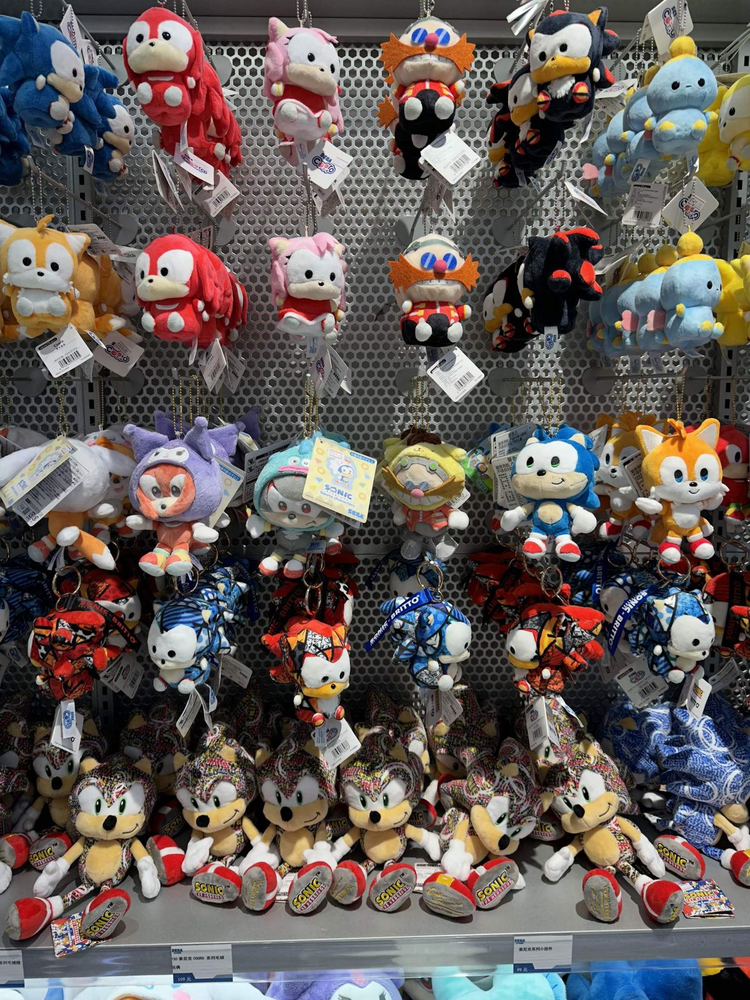

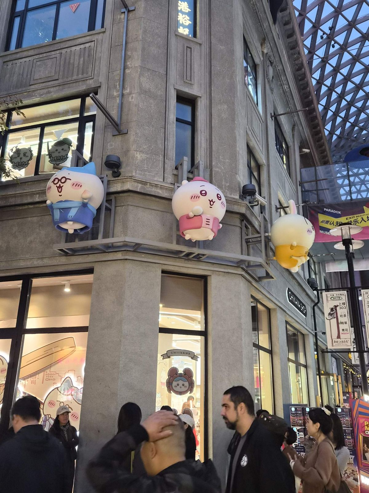
*건물 벽에 캐릭터들이 매달려 있어서 멀리서도 눈에 띄어요.*

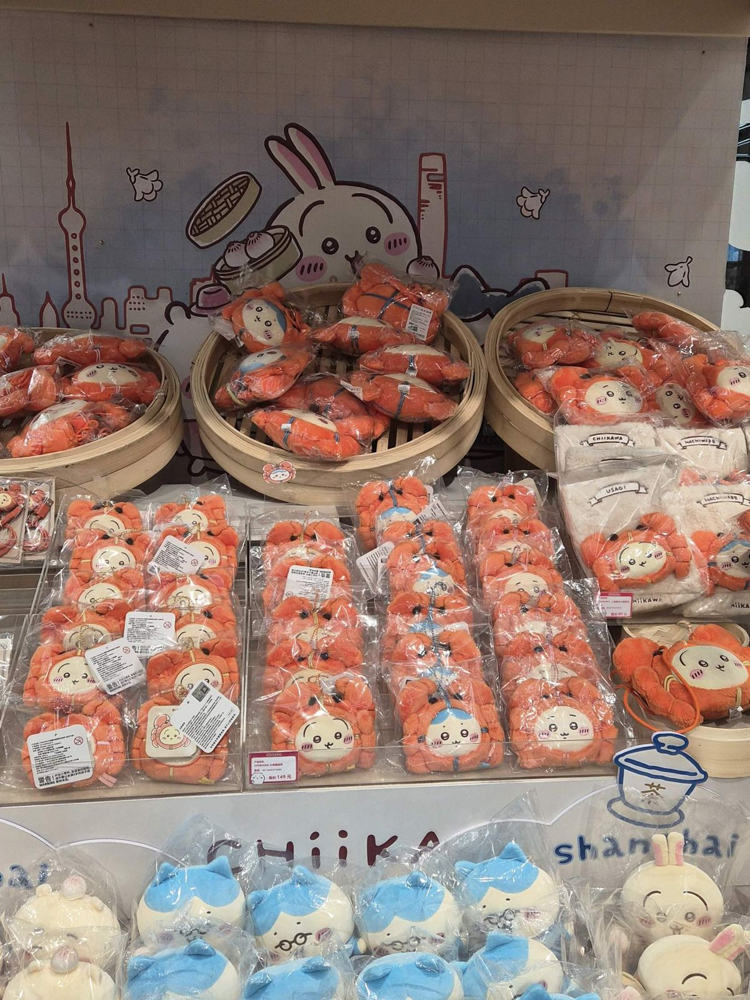

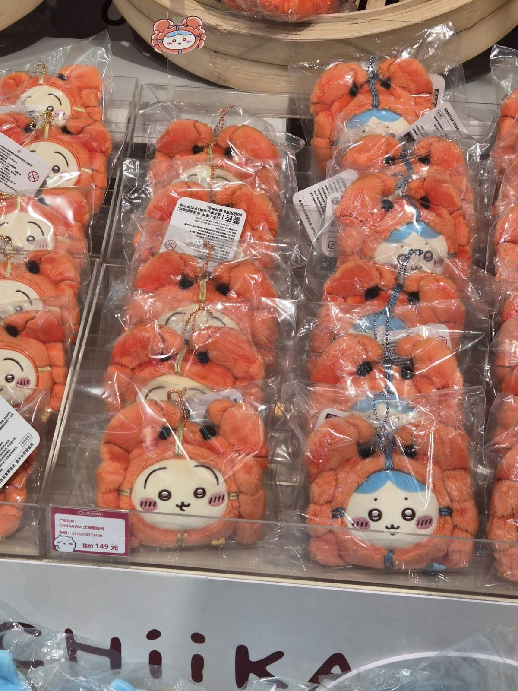
*털게 치이카와 키링. 가격표에 149元이라고 적혀 있어요.*

## 7. 와이탄: 저녁 6시 점등은 꼭 보세요

와이탄에서는 **저녁 6시에 조명이 켜지는 순간**을 봤습니다. 강변 건물들에 불이 한 번에 들어오고, 강 건너 동방명주와 푸둥 빌딩들까지 밝아지는 장면이 이날 최고의 순간이었어요.

- **점등 시간(참고):** 와이탄 경관 조명은 5~10월 19:00~23:00, 11~4월 18:00~22:00로 안내되어 있습니다 ([windhorsetour](https://windhorsetour.com/china-attraction/shanghai-bund), 2026-11-23 확인). 제가 간 11월 초에도 6시에 켜졌어요.
- **팁:** 점등 10~15분 전에 강변 자리를 잡으세요. 점등 직후에는 사람이 급격히 몰립니다.

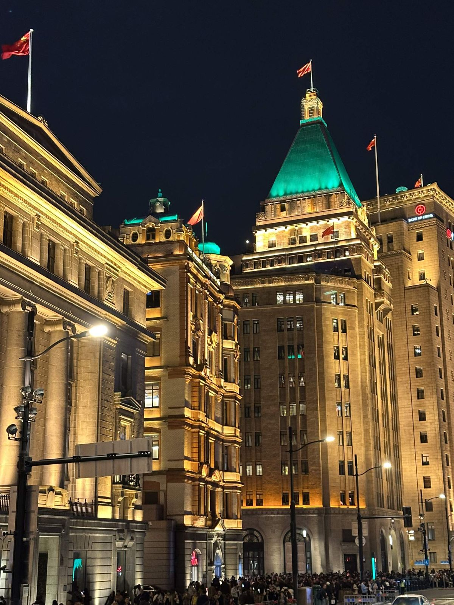
*조명이 들어온 와이탄 건물들. 아래쪽을 보면 사람이 얼마나 많은지 보여요.*

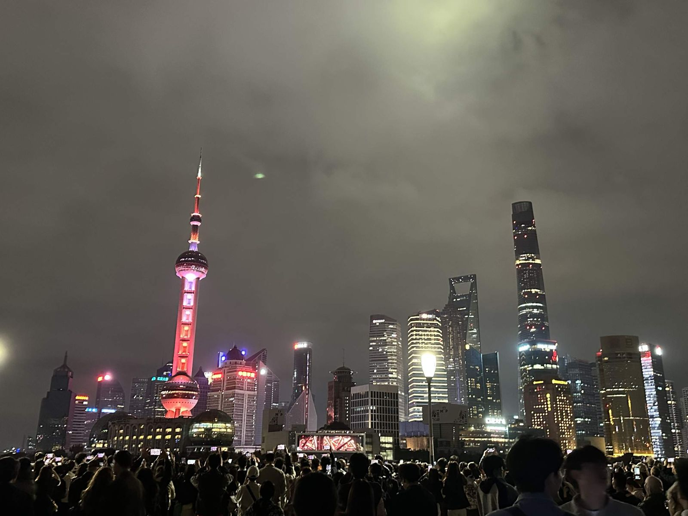
*강 건너 동방명주와 상하이 타워. 구름 낀 날이었는데도 멋있었어요.*

## 8. 저녁 전 남는 시간엔 2층 관광버스

The Fellas Terrace 예약이 저녁 7시 30분이라, 와이탄 점등을 보고 나서도 시간이 좀 남았어요. 그래서 **2층 시티투어 관광버스(City Sightseeing, 홉온 홉오프)**를 탔어요.

- **다리 쉬기에 최고예요.** 하루 종일 걸어서 다리가 아팠는데, 앉아서 야경을 구경하니 딱 좋았어요.
- **상하이 타워와 동방명주를 가까이서 볼 수 있어요.** 와이탄에서 강 건너로 보던 빌딩들을 바로 아래에서 올려다볼 수 있었어요.
- **이런 분께 추천:** 저녁 예약까지 1시간쯤 비는 분, 걷기 지친 분, 강 건너 푸둥까지 따로 갈 시간이 없는 분.
- TODO(확인 필요): 요금, 노선, 막차 시간, 표 사는 곳.

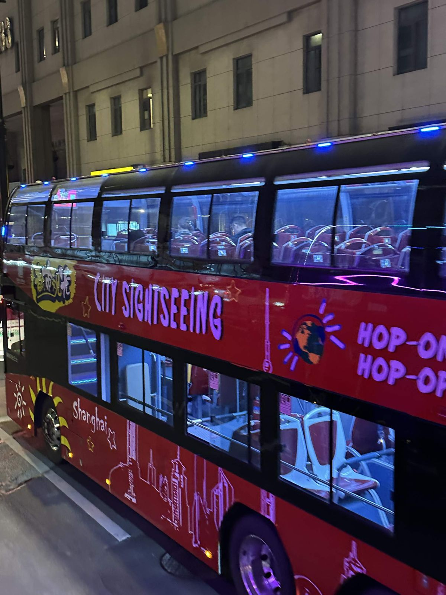

## 9. The Fellas Terrace 저녁: 영어가 통하는 뷰 맛집

저녁은 와이탄 남쪽에 있는 **The Fellas Terrace**에서 먹었습니다.

- **영어가 됩니다!** 중국 여행 중에는 영어가 잘 안 통하는 곳이 많은데, 이곳은 직원과 영어로 편하게 소통할 수 있었어요.
- **예약금 100위안:** 미리 예약할 때 **예약금 100위안**을 냅니다. 방문하면 나중에 환불 처리되지만, **노쇼하면 돌려받지 못해요.** 일정이 바뀌면 꼭 미리 취소하세요.
- **뷰:** 테라스에서 보는 야경이 정말 좋습니다.
- **분위기:** 정장을 멋지게 차려입은 외국인 손님이 많아서 분위기가 근사했어요.

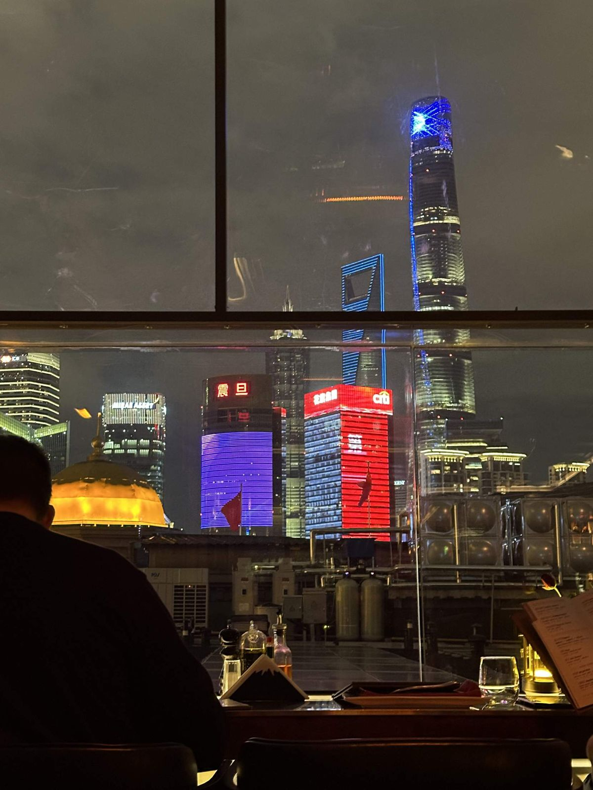
*자리에서 바로 보이는 상하이 타워와 푸둥 빌딩들.*

## 다녀와서 정리한 팁

| 항목 | 한 줄 정리 |
| --- | --- |
| 꼭 할 것 | 와이탄 점등(겨울 18시), 예상하이 동파육 |
| 시간 남을 때 | 2층 관광버스(앉아서 야경, 상하이 타워·동방명주 가까이) |
| 안 해도 되는 것 | 티엔즈팡 탕후루 |
| 기념품 | 핸드크림은 이름 대신 "上海" 각인, 마그넷 |
| 미리 할 것 | 점심·저녁 예약(The Fellas Terrace 예약금 100위안, 노쇼 시 환불 없음), 화장실 |
| 사람 많은 곳 | 인민광장, 예원(주말에는 사진 찍기 어려움) |
| 시간 주의 | 예원 정원 입장 마감 16시, 월요일 휴무 |

## 출발 전에 확인할 것

- **무비자:** 한국 일반 여권은 관광 목적으로 **최대 30일 무비자 입국**이 가능하며, 이 조치는 **2026년 12월 31일까지**입니다 ([China Services Info](https://www.chinaservicesinfo.com/s/202512/05/WS69327fe9498e3685503387b8/i-am-from-south-korea-and-plan-to-visit-china-sometime-in-january-2026-as-far-as-i-know-the-unilateral-visa-free-policy-for-us-expires-at-the-end-of-2025-do-i-need-to-apply-for-a-visa-to-enter-china.html)). 2026년 11월 17일 기준으로는 2027년 이후 연장 여부가 발표되지 않았습니다 ([코리아헤럴드](https://mbiz.heraldcorp.com/article/10940249)). 2027년에 간다면 출발 전에 꼭 다시 확인하세요.
- **결제:** 대부분 알리페이나 위챗페이 같은 간편결제를 씁니다. 출발 전에 앱을 설치하고 해외 카드를 연결해 두세요. TODO(확인 필요): 해외 카드 연결 수수료 기준.
- **언어:** 영어가 안 통하는 곳이 많습니다. 번역 앱과 함께, 식당 이름과 주소를 중국어로 저장해 두면 택시나 길 찾기가 훨씬 편해요.
- **근교에서 오는 경우:** 저는 자싱 쪽 숙소에서 기차와 지하철로 와서, 문 앞에서 첫 방문지까지 2시간 남짓 걸렸습니다. 고속철 역(훙차오역 등)에서 시내까지 지하철 이동 시간도 함께 잡으세요.

## XenoDay로 이 코스 짜기

1. **장소 담기:** 신천지, 예상하이, 티엔즈팡, 예원, 인민광장, 난징동루, 와이탄, The Fellas Terrace를 한 날짜에 넣으세요. 와이탄과 저녁 예약 사이에 시간이 비면 관광버스도 넣어 보세요.
2. **예약 시간 고정:** 점심 12:00, 저녁 19:30처럼 시간을 넣어 두면 **동선 정리**를 해도 두 식당의 순서가 고정됩니다.
3. **예원 시간 확인:** 예원 정원은 입장 마감이 16시라, 메모에 "16시 입장 마감"을 적어 두세요.
4. **가계부:** 위안(CNY)으로 지출을 적으면 그때 환율로 원화도 같이 기록됩니다. The Fellas Terrace 예약금 100위안은 나중에 환불되니, 메모에 "환불 예정"이라고 적어 두면 정산할 때 헷갈리지 않아요.
5. **체크리스트:** "알리페이 해외 카드 연결", "식당 예약", "보조배터리"를 출발 전 할 일에 넣어 두세요.

---

*이 글은 2026년 11월 7일 방문 경험을 바탕으로 썼습니다. 가격, 운영 시간, 입국 조건은 바뀔 수 있으니 출발 전에 한 번 더 확인하세요.*
